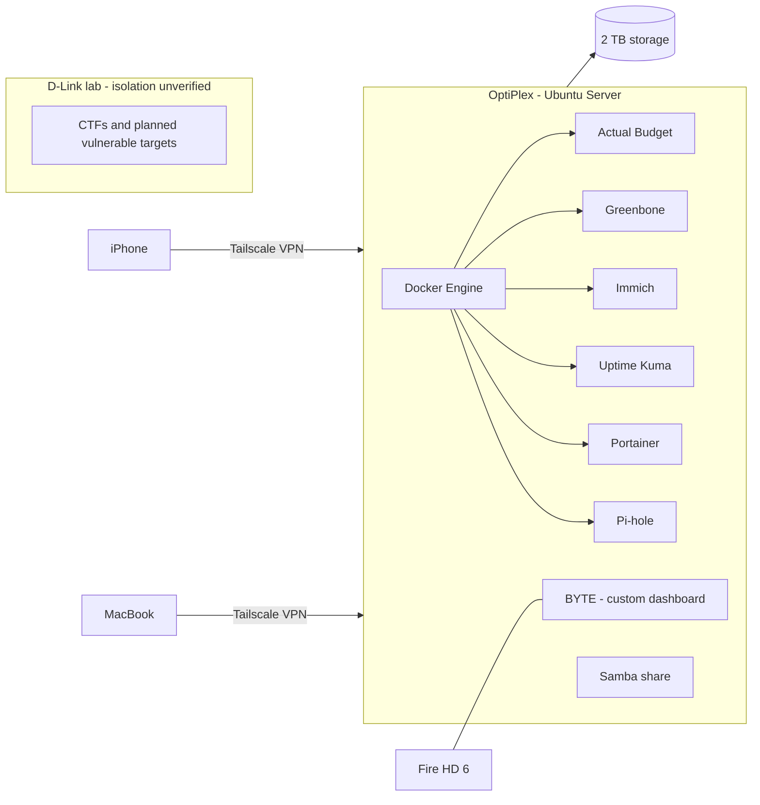

# BLCKBX1

### OPTIPLEXLAB — a personal infrastructure and cybersecurity laboratory

> Build. Break. Understand. Repeat.

BLCKBX1 is the public portfolio of OPTIPLEXLAB. OPTIPLEXLAB ACADEMY is my learning programme. 

BLCKBX1 documents the development of OPTIPLEXLAB, a self-hosted infrastructure and cybersecurity laboratory built around a repurposed Dell OptiPlex.

The project explores Linux administration, networking, containerisation, vulnerability management, automation and offensive and defensive security through practical experimentation.

A continuous record of builds, failures, troubleshooting, design decisions and lessons learned.

---

## Technical highlights

| Case study | Practical evidence |
|---|---|
| [Linux driver troubleshooting](docs/ugreen-driver.md) | Restored wireless connectivity through driver and firmware investigation |
| [Network security](docs/network-security.md) | Remote access, service boundaries and planned isolation verification |
| [Vulnerability management](security/tcp-timestamps.md) | Identified a low-severity finding and verified a configuration change; rescan pending |
| [BYTE](projects/BYTE/README.md) | Custom dashboard, API integration and repurposed hardware |

Technologies explored: Linux, Docker, Git, SSH, DNS, TCP/IP, Tailscale and Greenbone. 

## Documentation

| Documentation | Focus |
|---|---|
| [Learning journey](JOURNEY.md) | Progress and lessons learned |
| [UGREEN driver troubleshooting](docs/ugreen-driver.md) | Linux, firmware and DKMS |
| [Network security](docs/network-security.md) | Architecture and access controls |
| [Project BYTE](projects/BYTE/README.md) | Custom software development |
| [Vulnerability remediation](security/tcp-timestamps.md) | Blue-team case study |
| [Roadmap](ROADMAP.md) | Upcoming builds and purple-team goals |
| [Academy](ACADEMY.md) | Learning and independent skill development |
| [References](REFERENCES.md) | Infrastructure inspiration |
| [Architecture](architecture/README.md) | Network and rack documentation |
| [Evidence](assets/README.md) | Screenshot and publication checklist |

## TL;DR

- Headless Ubuntu server with self-hosted services and Tailscale remote access. Public exposure and current service bindings are pending a fresh audit.
- Selected admin dashboards locked to localhost and reached via **SSH tunnels**; key-based SSH; random database passwords and changed Greenbone default credentials.
- Ran a **vulnerability scan on my own server** with Greenbone, identified a low-severity finding and verified a kernel configuration change. A follow-up scan and persistence check are planned.
- This repository is a growing record of what I build, what breaks, how I troubleshoot it and what I learn.

---

## Hardware

### Dell OptiPlex 7050 Micro
| Part | Spec |
|------|------|
| CPU | Intel Core i7-7700T |
| RAM | 8 GB DDR4 |
| Boot drive | 256 GB NVMe SSD |
| Storage | 2 TB Seagate One Touch (USB, ext4) |
| Network | UGREEN AX900 USB Wi-Fi 6 + USB Bluetooth adapter |
| OS | Ubuntu Server 26.04 LTS (headless) |

### Dashboard device
Amazon Fire HD 6 (2014), repurposed for BYTE.

### D-Link DIR-X3000Z (AX3000 Wi-Fi 6)
Working dedicated lab router with an internet uplink connected when required. Isolation must be verified before security testing.

---

## Architecture

Logical service-access sketch; the D-Link uplink path and isolation are not yet verified. See [architecture notes](architecture/README.md).

---

## Services

| Tool | Purpose |
|------|---------|
|  | Server OS |
|  | Containers |
|  | Private remote access (VPN) |
|  | DNS sinkhole and ad blocking |
|  | Docker management UI |
|  | Service monitoring |
|  | Self-hosted photo management |
|  | Self-hosted budgeting |
|  | Network file share |
|  | Vulnerability scanning |
| BYTE | My custom music player and server monitoring dashboard |

## Previously configured security choices

These describe prior configuration, not a current independent security audit.

- **Remote access via Tailscale.** Internet exposure has not been independently verified; Immich listens on all interfaces.
- **Admin dashboards locked to localhost.** Portainer, Uptime Kuma, Greenbone, Actual and the Pi-hole admin page only listen on the server itself; I reach them through SSH tunnels.
- **Least-privilege file sharing.** The Samba share allows one named user, no guests.
- **Credential hardening.** Database passwords are randomly generated; changed Greenbone's default admin login.
- **Secret handling.** `.env` files are excluded with `.gitignore`; repository history has not been audited for secrets.
- **Key-based SSH** from my Mac.

---

## Build journal

[Detailed builds and troubleshooting history](docs/build-journal.md) — Linux drivers, networking, BYTE, Samba, Immich, Greenbone and Actual Budget.

## Screenshots

[Portainer dashboard](./portainer.png) · [Running containers](./containers.png)

### DNS filtering — Pi-hole

35,122 DNS queries, 2,997 blocked (8.5%) and 302,818 domains on lists at capture time.

### Vulnerability management — Greenbone

195,084 available vulnerability tests; latest task severity 2.6 (Low). This is not a count of vulnerabilities found.

### Monitoring and self-hosting

| Service | Evidence |
|---|---|
| Uptime Kuma | [SSH monitor](assets/uptime-kuma.png) |
| Immich | [Photo service](assets/immich.png) |
| Actual Budget | [Budget interface](assets/actual-budget.png) |
| Tailscale | [Connected devices](assets/tailscale.png) |

[View the complete nine-image gallery](assets/README.md).

## Project roadmap

| Project | Purpose | Status |
|---|---|---|
| OPTIPLEXLAB | Core infrastructure | Existing; audit pending |
| BYTE | Custom dashboard | Existing; redesign planned |
| BYTE MINI | CYD touchscreen | Planned |
| ORBIT | Satellite tracking | Planned |
| TRAP | Cowrie honeypot | Planned |
| SENTINEL | SOC and detection | Planned |
| GODSEYE | Authorised intelligence research | Candidate; upstream project to verify |
| Infrastructure dashboard | Glance and Homelable | Planned |
| Cloud lab | Proxmox, Kubernetes and GitOps | Planned |

See [the full roadmap](ROADMAP.md). Reliability and backups come before new deployments.

---

## Project direction

The lab will explore offensive and defensive security through purple-team exercises: simulate an authorised attack, collect telemetry, investigate, mitigate and retest. This repository documents the evolution of the lab, including design decisions, experiments and verified outcomes.

All security testing is limited to systems I own or have explicit permission to assess. Sensitive configuration and credentials must remain outside the public repository.

**Build. Break. Understand. Repeat.**

## Acknowledgements
- [awesome-selfhosted](https://awesome-selfhosted.net/)
- [Markdown Badges](https://github.com/Ileriayo/markdown-badges)
- [r/homelab](https://www.reddit.com/r/homelab/wiki/introduction)
