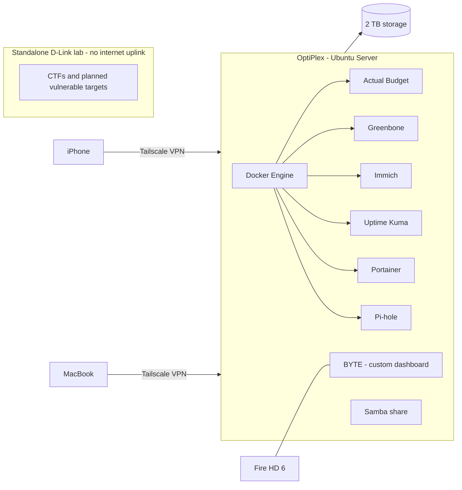
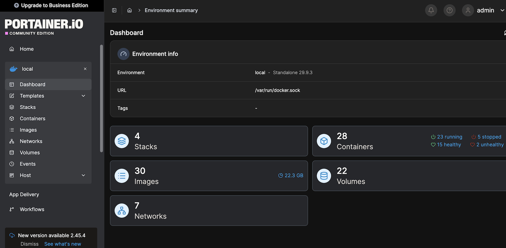
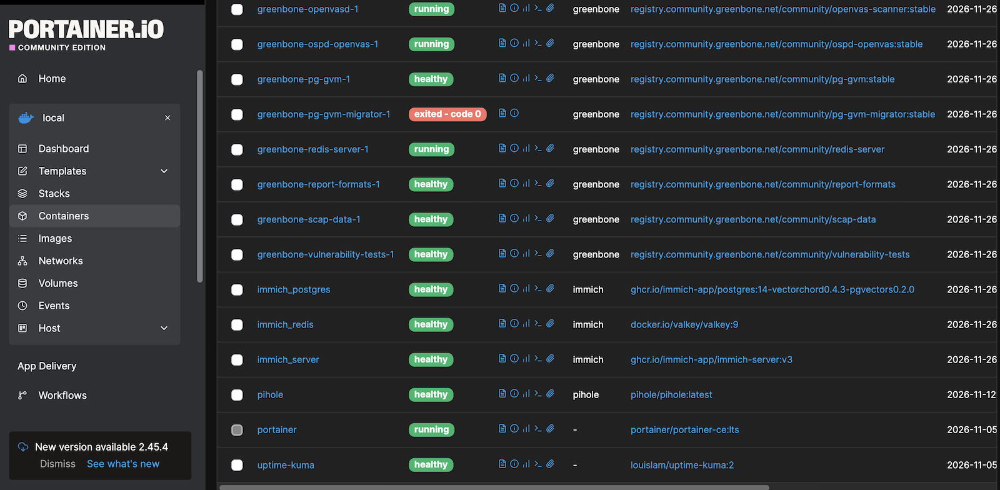
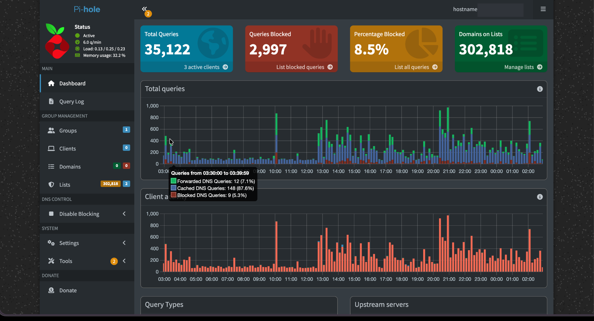
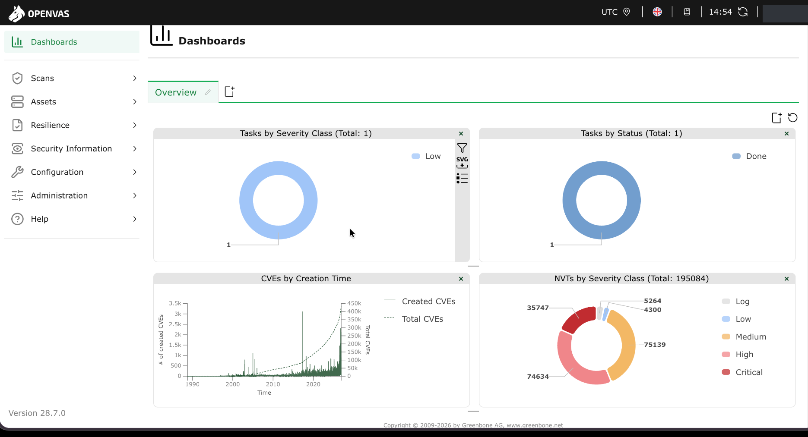

# BLCKBX1

### OPTIPLEXLAB — a personal infrastructure and cybersecurity laboratory

> Build. Break. Understand. Repeat.

BLCKBX1 is the public portfolio of OPTIPLEXLAB. OPTIPLEXLAB ACADEMY is my learning programme. The repository was renamed to BLCKBX1.

A living document of my homelab: an old Dell OptiPlex turned into a self-hosted server I use to learn Linux, Docker, networking and security hands-on.

I'm a Bachelor of IT (Cybersecurity) student at Macquarie University, building towards a career in cybersecurity, with interests across **blue team and red team**. This lab is where I practise both sides: running services securely, monitoring them, and finding and fixing vulnerabilities, then documenting what I learn.

> **What is a homelab?**
> A small lab at home for self-hosting apps, testing new tech and practising for certifications, without risking anything in production.

---

## Explore the portfolio

I started this project during my third year of university after realising how important practical experience is. Rather than wishing I had started earlier, I decided to start now.

| Documentation | Focus |
|---|---|
| [Learning journey](JOURNEY.md) | Progress and lessons learned |
| [UGREEN driver troubleshooting](docs/ugreen-driver.md) | Linux, firmware and DKMS |
| [Network security](docs/network-security.md) | Architecture and access controls |
| [Project BYTE](projects/BYTE/README.md) | Custom software development |
| [Vulnerability remediation](security/tcp-timestamps.md) | Blue-team case study |
| [Roadmap](ROADMAP.md) | Upcoming builds and purple-team goals |
| [Academy](ACADEMY.md) | Learning and independent skill development |
| [References](REFERENCES.md) | Infrastructure inspiration |
| [Architecture](architecture/README.md) | Network and rack documentation |
| [Evidence](assets/README.md) | Screenshot and publication checklist |

## TL;DR

- Headless Ubuntu server with self-hosted services and Tailscale remote access. Public exposure and current service bindings are pending a fresh audit.
- Selected admin dashboards locked to localhost and reached via **SSH tunnels**; key-based SSH; random database passwords and changed Greenbone default credentials.
- Ran a **vulnerability scan on my own server** with Greenbone, found a finding, fixed it, and verified the kernel configuration change. A follow-up scan is planned.
- This repository is a growing record of what I build, what breaks, how I troubleshoot it and what I learn.

---

## Hardware

### Dell OptiPlex 7050 Micro
| Part | Spec |
|------|------|
| CPU | Intel Core i7-7700T |
| RAM | 8 GB DDR4 |
| Boot drive | 256 GB NVMe SSD |
| Storage | 2 TB Seagate One Touch (USB, ext4) |
| Network | UGREEN AX900 USB Wi-Fi 6 + USB Bluetooth adapter |
| OS | Ubuntu Server 26.04 LTS (headless) |

### Dashboard device
Amazon Fire HD 6 (2014), repurposed for BYTE.

### D-Link DIR-X3000Z (AX3000 Wi-Fi 6)
Last documented as a standalone lab without an internet uplink. Isolation must be verified before security testing.

---

## Architecture

---

## Services

| Tool | Purpose |
|------|---------|
|  | Server OS |
|  | Containers |
|  | Private remote access (VPN) |
|  | DNS sinkhole and ad blocking |
|  | Docker management UI |
|  | Service monitoring |
|  | Self-hosted photo backup |
|  | Self-hosted budgeting |
|  | Network file share |
|  | Vulnerability scanning |
| BYTE | My custom music player and server monitoring dashboard |

## Previously configured security choices

These describe prior configuration, not a current independent security audit.

- **Remote access via Tailscale.** Internet exposure has not been independently verified; Immich listens on all interfaces.
- **Admin dashboards locked to localhost.** Portainer, Uptime Kuma, Greenbone, Actual and the Pi-hole admin page only listen on the server itself; I reach them through SSH tunnels.
- **Least-privilege file sharing.** The Samba share allows one named user, no guests.
- **Credential hardening.** Database passwords are randomly generated; changed Greenbone's default admin login.
- **Secrets stay out of Git.** `.env` files are excluded with `.gitignore`.
- **Key-based SSH** from my Mac.

---

## Journey — November 2026 onwards

### 01. Linux foundations and UGREEN driver troubleshooting
Installed headless Ubuntu Server and configured remote administration from my Mac. Getting the UGREEN AX900 working required identifying the AIC8800D80 chipset, troubleshooting USB mode switching, firmware, kernel modules and DKMS, and configuring Netplan. Wireless connectivity and SSH access now work.

**Topics explored:** Linux hardware compatibility, kernel logs, driver dependencies and systematic troubleshooting.

### 02. Networking and container infrastructure
Explored static addressing, subnetting, DHCP, DNS, NAT, Linux forwarding, iptables and UFW while experimenting with the D-Link router. Investigated Tailscale DNS issues and deployed Docker, Pi-hole, Portainer and Uptime Kuma. The D-Link was last documented as a standalone lab; isolation remains to be verified.

**Topics explored:** network boundaries, secure remote access, service dependencies and the importance of verifying changes.

### 03. BYTE — my own software project
BYTE is a music player and server monitoring dashboard I built, with Spotify integration and a minimalist interface on a repurposed Fire HD 6 tablet. It combines a self-hosted backend, API integration, Android/ADB experimentation and interface design. BYTE is an ongoing project, not a third-party application.

**Topics explored:** application development, deployment, API integration and debugging.

### 04. Personal cloud and vulnerability management
Expanded storage, deployed personal services and began assessing the security of my own infrastructure. The builds below document this stage.

## Builds

### 1. Storage + Samba share
Added a 2 TB drive and shared it to my Mac and iPhone.
- Partitioned with GPT and formatted as ext4
- Auto-mounted via `/etc/fstab` using the drive's UUID and `nofail`, so the server still boots if the USB drive is unplugged
- Samba share restricted to one user; enabled Apple compatibility (`vfs_fruit`) to fix read-only access on iOS

**Topics explored:** why a 2 TB drive shows as 1.8 TiB in Linux (decimal vs binary units), and why SMB needs locking down (it's been the target of major attacks like WannaCry).

### 2. Immich (photo backup)
Self-hosted alternative to Google Photos, running in Docker.
- Database on the fast SSD, photos on the 2 TB drive
- Machine learning disabled to fit in 8 GB of RAM
- Default database password replaced with a random one

**Topics explored:** Docker Compose, splitting storage by speed, and why membership of the `docker` group is effectively root access.

### 3. Greenbone / OpenVAS (vulnerability scanning)
Ran a full vulnerability scan against my own server.
- Deployed the Greenbone stack (~19 containers) in Docker; loaded 195,000+ vulnerability tests
- Scanned the server, triaged the findings by severity
- **Finding:** TCP timestamps enabled, which can leak server uptime (Low severity)
- **Fix:** disabled with `net.ipv4.tcp_timestamps = 0` in `sysctl`
- **Verified:** confirmed the setting is off; rescan to confirm it clears

**Topics explored:** how to read a vulnerability report, tell a real finding from an informational one, and the scan → fix → verify loop that vulnerability management runs on.

### 4. Actual Budget
Self-hosted budgeting app in Docker, locked to localhost and reached over an SSH tunnel.

---

## Troubleshooting journal

| Problem | Resolution / lesson |
|---|---|
| UGREEN Wi-Fi adapter not working | Investigated chipset, USB mode switching, firmware and DKMS; restored connectivity |
| Tailscale DNS issues | Investigated resolver configuration and VPN DNS behaviour |
| Docker permission denied | Configured Docker group membership; learned it is effectively root-equivalent |
| iOS Samba share read-only | Configured Apple-compatible `vfs_fruit` |
| Empty Immich database password | Used `/dev/urandom` to generate credentials when OpenSSL was unavailable |
| Localhost-only dashboards inaccessible remotely | Used SSH tunnels rather than exposing administrative ports |
| Limited RAM | Disabled Immich machine learning |
| Git push blocked by email privacy | Configured GitHub no-reply email and PAT authentication |

## Screenshots

### Portainer dashboard

### Running containers

### DNS filtering — Pi-hole

35,122 DNS queries, 2,997 blocked (8.5%) and 302,818 domains on lists at capture time.

### Vulnerability management — Greenbone

195,084 available vulnerability tests; latest task severity 2.6 (Low). This is not a count of vulnerabilities found.

### Monitoring and self-hosting

| Service | Evidence |
|---|---|
| Uptime Kuma | [SSH monitor](assets/uptime-kuma.png) |
| Immich | [Photo service](assets/immich.png) |
| Actual Budget | [Budget interface](assets/actual-budget.png) |
| Tailscale | [Connected devices](assets/tailscale.png) |

[View the complete nine-image gallery](assets/README.md).

## Project roadmap

| Project | Purpose | Status |
|---|---|---|
| OPTIPLEXLAB | Core infrastructure | Existing; audit pending |
| BYTE | Custom dashboard | Existing; redesign planned |
| BYTE MINI | CYD touchscreen | Planned |
| ORBIT | Satellite tracking | Planned |
| TRAP | Cowrie honeypot | Planned |
| SENTINEL | SOC and detection | Planned |
| GODSEYE | Authorised intelligence research | Candidate; upstream project to verify |
| Infrastructure dashboard | Glance and Homelable | Planned |
| Cloud lab | Proxmox, Kubernetes and GitOps | Planned |

See [the full roadmap](ROADMAP.md). Reliability and backups come before new deployments.

---

## Career direction

My goal is to develop both offensive and defensive security skills, eventually combining them in purple-team exercises: simulate an authorised attack, collect telemetry, investigate, mitigate and retest. This repository will grow alongside my degree and document my progress towards a cybersecurity role.

All security testing is limited to systems I own or have explicit permission to assess. Sensitive configuration and credentials must remain outside the public repository.

**Build. Break. Understand. Repeat.**

## Acknowledgements
- [awesome-selfhosted](https://awesome-selfhosted.net/)
- [Markdown Badges](https://github.com/Ileriayo/markdown-badges)
- [r/homelab](https://www.reddit.com/r/homelab/wiki/introduction)
