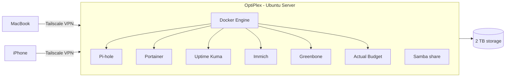

# Homelab :sparkles:

A living document of my homelab: an old Dell OptiPlex turned into a self-hosted server I use to learn Linux, Docker, networking and security hands-on.

I'm a Bachelor of IT (Cybersecurity) student at Macquarie University, building towards a career in cybersecurity, with interests across **blue team and red team**. This lab is where I practise both sides: running services securely, monitoring them, and finding and fixing vulnerabilities, then documenting what I learn.

> **What is a homelab?**
> A small lab at home for self-hosting apps, testing new tech and practising for certifications, without risking anything in production.

---

## TL;DR

- Headless Ubuntu server running **8+ services** in Docker, reachable only over a **Tailscale VPN** (nothing exposed to the internet).
- Admin dashboards locked to localhost and reached via **SSH tunnels**; key-based SSH; no default passwords.
- Ran a **vulnerability scan on my own server** with Greenbone, found a finding, fixed it, and verified the fix on rescan.
- Every build is documented here with what I did, why, and what I learned.

---

## Hardware

### Dell OptiPlex 7050 Micro
| Part | Spec |
|------|------|
| CPU | Intel Core i7-7700T |
| RAM | 8 GB DDR4 |
| Boot drive | 256 GB NVMe SSD |
| Storage | 2 TB Seagate One Touch (USB, ext4) |
| Network | USB Wi-Fi adapter + USB Bluetooth adapter |
| OS | Ubuntu Server 26.04 LTS (headless) |

### D-Link DIR-X3000Z (AX3000 Wi-Fi 6)
A standalone, isolated network with no internet uplink. Used for security testing and for hosting a Wi-Fi CTF challenge.

---

## Architecture

---

## Services

| Tool | Purpose |
|------|---------|
|  | Server OS |
|  | Containers |
|  | Private remote access (VPN) |
|  | DNS sinkhole and ad blocking |
|  | Docker management UI |
|  | Service monitoring |
|  | Self-hosted photo backup |
|  | Self-hosted budgeting |
|  | Network file share |
|  | Vulnerability scanning |

---

## Security choices

- **No ports open to the internet.** Remote access only through Tailscale.
- **Admin dashboards locked to localhost.** Portainer, Uptime Kuma, Greenbone, Actual and the Pi-hole admin page only listen on the server itself; I reach them through SSH tunnels.
- **Least-privilege file sharing.** The Samba share allows one named user, no guests.
- **No default passwords.** Database passwords are randomly generated; changed Greenbone's default admin login.
- **Secrets stay out of Git.** `.env` files are excluded with `.gitignore`.
- **Key-based SSH** from my Mac.

---

## Builds

### 1. Storage + Samba share
Added a 2 TB drive and shared it to my Mac and iPhone.
- Partitioned with GPT and formatted as ext4
- Auto-mounted via `/etc/fstab` using the drive's UUID and `nofail`, so the server still boots if the USB drive is unplugged
- Samba share restricted to one user; enabled Apple compatibility (`vfs_fruit`) to fix read-only access on iOS

**Learned:** why a 2 TB drive shows as 1.8 TiB in Linux (decimal vs binary units), and why SMB needs locking down (it's been the target of major attacks like WannaCry).

### 2. Immich (photo backup)
Self-hosted alternative to Google Photos, running in Docker.
- Database on the fast SSD, photos on the 2 TB drive
- Machine learning disabled to fit in 8 GB of RAM
- Default database password replaced with a random one

**Learned:** Docker Compose, splitting storage by speed, and why membership of the `docker` group is effectively root access.

### 3. Greenbone / OpenVAS (vulnerability scanning)
Ran a full vulnerability scan against my own server.
- Deployed the Greenbone stack (~19 containers) in Docker; loaded 195,000+ vulnerability tests
- Scanned the server, triaged the findings by severity
- **Finding:** TCP timestamps enabled, which can leak server uptime (Low severity)
- **Fix:** disabled with `net.ipv4.tcp_timestamps = 0` in `sysctl`
- **Verified:** confirmed the setting is off; rescan to confirm it clears

**Learned:** how to read a vulnerability report, tell a real finding from an informational one, and the scan → fix → verify loop that vulnerability management runs on.

### 4. Actual Budget
Self-hosted budgeting app in Docker, locked to localhost and reached over an SSH tunnel.

---

## Roadmap

- [x] Ubuntu Server, Tailscale, Docker
- [x] Pi-hole, Portainer, Uptime Kuma
- [x] 2 TB storage + Samba
- [x] Immich
- [x] Greenbone vulnerability scan + first fix
- [x] Actual Budget
- [ ] Automated backups (restic, 3-2-1 rule)
- [ ] Harden SSH: key-only, disable password login, MFA
- [ ] Wazuh SIEM: collect logs and alert on attacks
- [ ] Isolated lab network with vulnerable targets (Juice Shop, DVWA)
- [ ] Red + blue project: attack a target, detect it in Wazuh, document it
- [ ] RAM upgrade to run heavier services

---

## Acknowledgements
- [awesome-selfhosted](https://awesome-selfhosted.net/)
- [Markdown Badges](https://github.com/Ileriayo/markdown-badges)
- [r/homelab](https://www.reddit.com/r/homelab/wiki/introduction)
