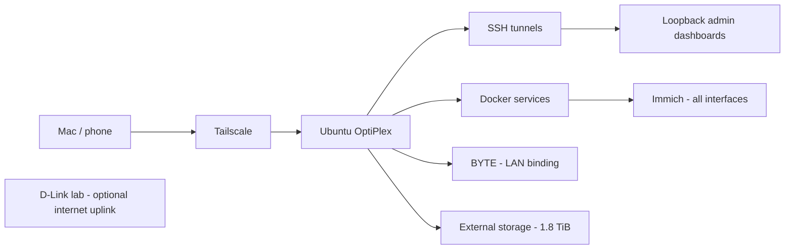

# Architecture

See the existing [network security notes](../docs/network-security.md). The current physical and logical topology requires verification before publishing a definitive diagram.

Planned evidence: manual Homelable diagram, network boundaries, authorised lab scope, service dependencies, remote access paths and future rack layout. Verify isolation before deploying vulnerable targets. Do not publish private addresses or credentials unnecessarily.

## Observed infrastructure — 27 November 2026

This is a logical service-access sketch, not a verified physical network map. The D-Link has working internet connectivity when required, as reported by the lab owner. Its exact uplink path and isolation have not been independently verified; no permanent connection is asserted.

## Capacity snapshot

- RAM: 7.1 GiB visible, 2.8 GiB used, 4.3 GiB available.
- Swap: 793 MiB used of 4 GiB.
- Root filesystem: 232 GiB, 34% used.
- External storage: 1.8 TiB mounted, 185 MiB used.

[Service evidence](../assets/README.md).
