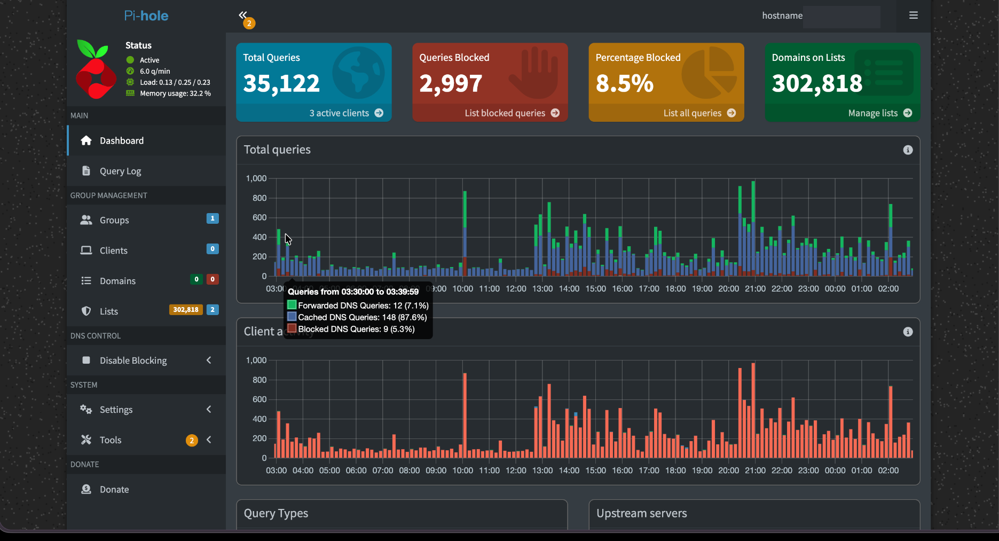
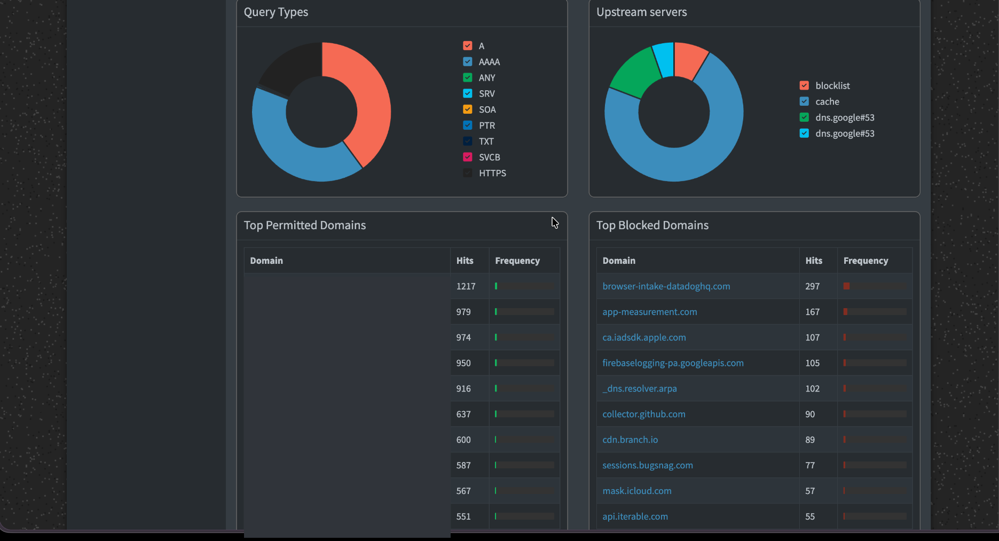
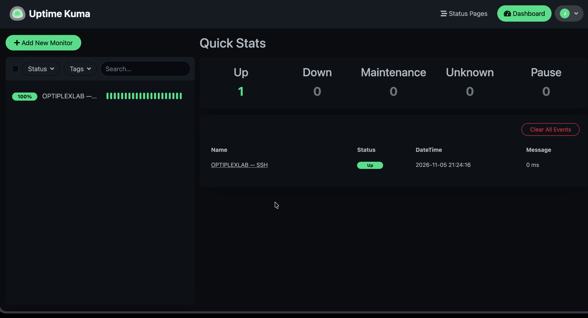
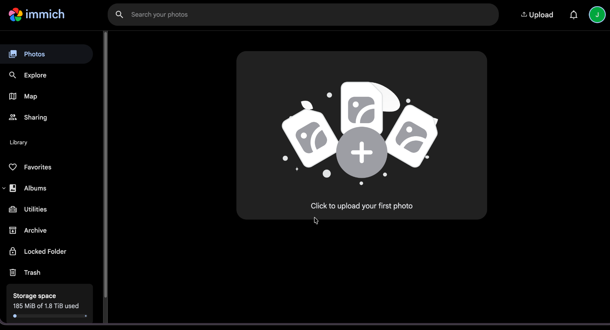
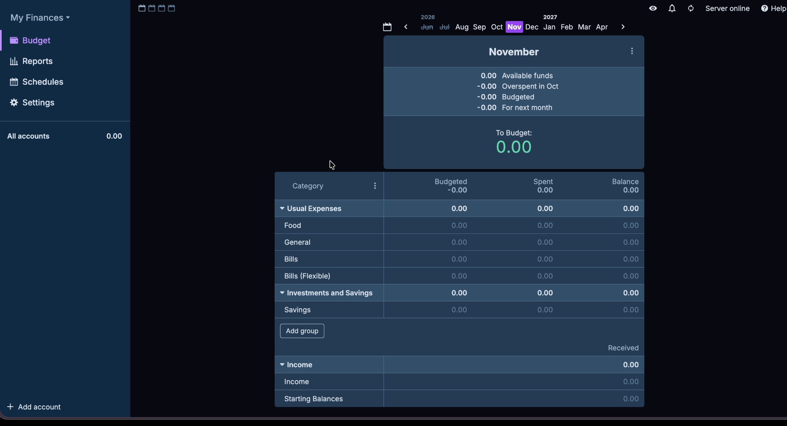
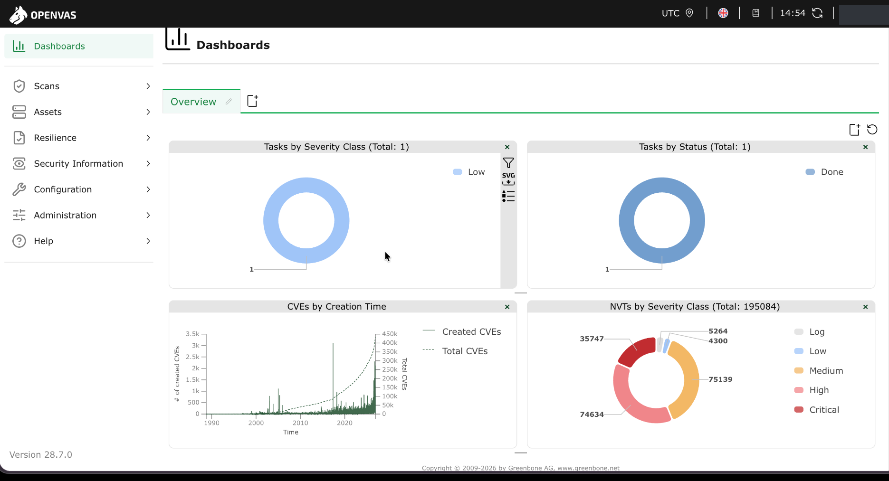
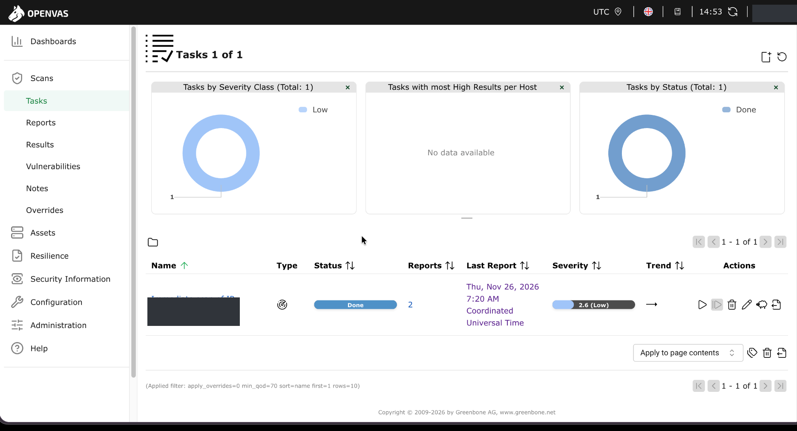
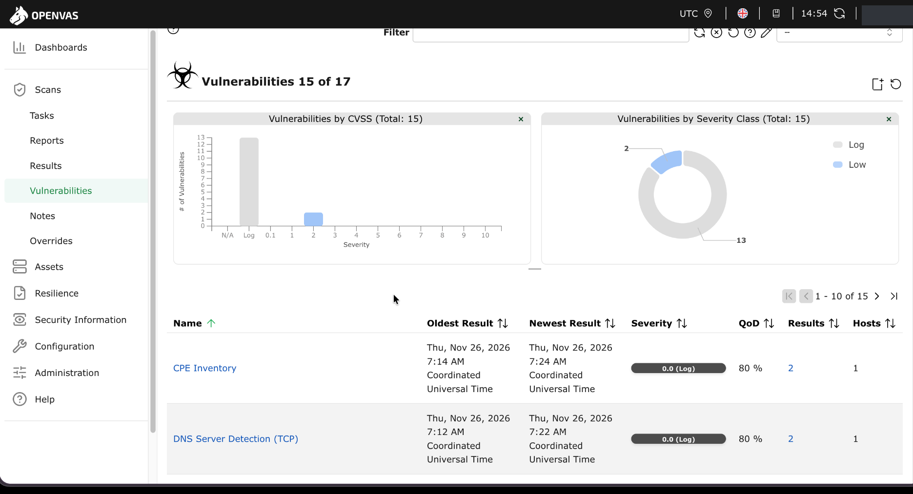
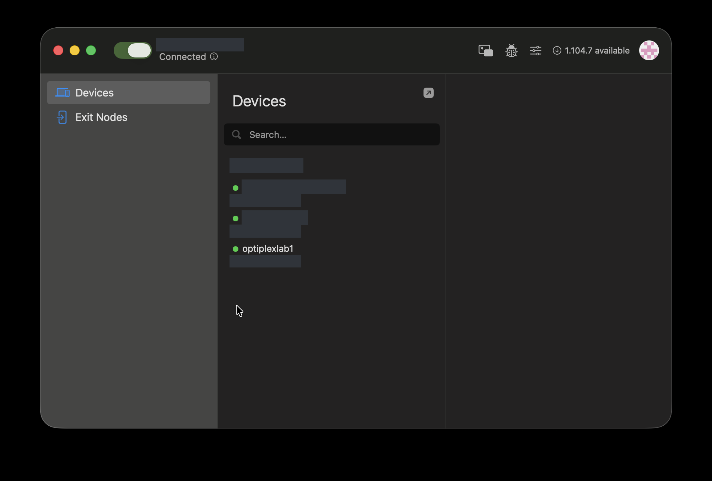

# Service screenshot gallery

Evidence collected 27 November 2026 (Sydney time). Screenshots show deployment and point-in-time observations, not a comprehensive security audit.

## Pi-hole

35,122 DNS queries, 2,997 blocked (8.5%), 302,818 domains on lists.

## DNS analytics

Query types and upstream resolver statistics.

## Uptime Kuma

One SSH monitor reporting 100% uptime in the displayed view.

## Immich

Photo service accessible; empty library, 1.8 TiB storage shown.

## Actual Budget

Self-hosted budgeting interface online.

## Greenbone dashboard

195,084 available vulnerability tests, not vulnerabilities found.

## Greenbone scan task

Completed task with two reports; latest task severity 2.6 (Low).

## Greenbone findings

Filtered view across results: two low-severity entries and 13 informational entries.

## Tailscale

Three connected devices shown.

## Remaining evidence

- [ ] Physical setup and hardware photos
- [ ] BYTE and Samba screenshots
- [ ] Verified network diagram
- [ ] Individual latest scan report and remediation retest evidence

Review redactions before further public sharing.
